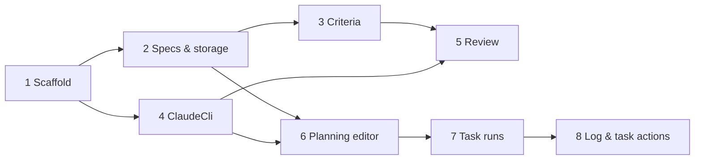

# Implementation Plan

Breaks [PRD.md](PRD.md) down into tasks. Designs are in [plugin-design.zip](plugin-design.zip).

Tasks 1 and 4 can run in parallel, as can 5 and 6 once their dependencies are done.

## 1. Extension scaffold and repository resolution

- TypeScript VS Code extension with a **Spec Plans** activity bar container and three empty views: Specifications, Maturity, Non-functional Criteria
- Resolve the open workspace to its main worktree, and read its `origin` remote
- Look the remote up in `~/.spec-plans/repositories.yml`. If it's missing, offer to register it with the default folder name (e.g. `githubcom-ceilingfish-foo`)
- A workspace with no `origin` remote shows a prompt to register it by hand

**Done when:** opening the main repo or any of its worktrees resolves to the same repository folder.

## 2. Specs and storage

- Create `~/.spec-plans` as a git repository on first use, with a `.gitignore` excluding `runs/*.log`
- Specifications view: flat list of specs from `<repo>/plans/`, with the phase icon from `spec.md` frontmatter, and `spec.md` plus attachments as children
- **Add** creates a spec with a unique slug; clicking a document opens it in an editor tab
- **Commit** commits all changes in `~/.spec-plans`; **Refresh**; **Filter** to hide completed specs
- Define the `spec.md` frontmatter (at least `phase`)

**Done when:** specs can be created, opened, edited and committed without touching the code repository.

## 3. Non-functional criteria

- Resolve criteria from `~/.spec-plans/.non-functional/` and `<repo>/.non-functional/` (repository wins by name), honouring `disabled: true` in frontmatter
- Non-functional Criteria view with global / repository / disabled icons
- Context menu: Open, Scope to repository (copies), Revert to global definition (deletes the copy), Disable, Disable for this repository, Enable. Title bar: Add, Refresh
- Write the six default criteria as falsifiable rubrics, each with a "Not applicable when" section: security, observability, disaster-recovery, cost-efficiency, design-completeness, edge-cases

**Done when:** the view shows the resolved set for a repository, and every menu action produces the correct files.

## 4. Execution strategy and ClaudeCli

- An execution strategy interface: start (working directory + prompt), stream the log, cancel, final status, resume a session
- **ClaudeCli**: runs `claude` headless in auto permission mode, with streaming JSON output parsed into log entries
- Agents are children of the extension: closing VS Code kills them, and any run left marked as running is recorded as cancelled on the next start

**Done when:** the extension can run a prompt in a given directory, show its streamed output, and cancel it.

## 5. Maturity review

- Review prompt: the spec, its attachments and every enabled criterion, with the reviewer returning the `criteria` array from the PRD's review format
- Save reviews to `reviews/<timestamp>.json`, with document hashes
- Spinner on the spec while a review runs; **Review maturity** in the spec context menu and the Maturity view title bar
- Maturity view: latest review, one row per criterion with status and short result; **History** lists earlier reviews
- Review result editor (double-click a criterion): status badge, summary, Gaps and Covered findings
- White / yellow document labels from the stored hashes; "weakest: …" and "ready to plan" on spec rows

**Done when:** reviewing a spec produces a stored review, the Maturity view and result editor show it, and editing a document turns it yellow.

## 6. Planning editor

- Webview editor opened by **Plan tasks**: task list on the left, planner conversation on the right, **Accept plan** in the header
- The planner runs through ClaudeCli, resuming the same session for each message, and returns the planner output format from the PRD
- Edit (pencil), delete, drag to reorder, select and merge, **New task**, for tasks that haven't started
- Started tasks keep their position and serial and can't be deleted or merged, but can be redefined
- Accept writes `tasks/<serial>-<name>/task.md`, snapshots previous versions into `versions/`, increments versions, records the plan revision in `planning/`, and moves the spec to Planning
- Tasks node in the Specifications view; yellow labels for tasks altered since their last run

**Done when:** a spec can be planned, replanned and accepted, with task serials and versions following the PRD.

## 7. Task runs

- **Start**: first time only, create `feature/<spec>-<serial>-<task>` off `main` and a worktree at `../<repo-folder>-<spec>-<serial>-<task>`; fail clearly if `main` doesn't exist
- Run ClaudeCli in the worktree with the spec and current task version in the prompt
- Record each run in `runs/<n>.json` (task version, start, end, status) with its log in `runs/<n>.log`
- Task icons: pending, running, has worktree, complete. **Cancel**, **Run all**
- Spec moves to Execution when its first task starts

**Done when:** starting a task creates the branch and worktree, runs the agent there, and the tree reflects its state throughout.

## 8. Agent log and task actions

- Agent log editor: runs on the left, the selected run's log on the right, **Cancel** while running
- Task context menu: View Log, Open In VS Code (disabled before first start), Mark complete, Remove (pending tasks only)
- Merge detection with `git branch --merged main`; a task with a removed worktree is complete if merged, otherwise pending
- Spec moves to Complete when all its tasks are complete

**Done when:** every task menu action works, and a spec reaches Complete.
