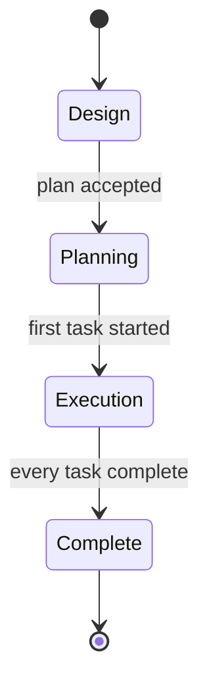

# Specification Design Plugin

## Problem

I like writing specifications when I am developing features. However these specifications keep on ending up in the repository, usually on a dedicated "planning" branch. I have no way of evolving a spec over time and seeing how _mature_ it is before I start building it.

This is a VS Code extension that lets me author, evolve and track specifications **outside of the repository**, measure their maturity against a set of criteria, break them down into tasks, and dispatch agents to work on those tasks.

## Goals

- Manage specs for a repository from within VS Code, without storing them in that repository
- Make maturity of a spec visible: edge cases, compliance with non-functional criteria, design completeness
- Allow AI agents to review, critique and extend specs
- Break a mature spec down into versioned tasks, and dispatch those tasks to agents in their own worktrees
- Show which agents are running, and keep a record of every run

## Non-goals

- Multi-user / team collaboration. This is a tool for one person.
- Stable repository identity across machines
- Specs that span multiple repositories
- A custom chart or Mermaid editor
- Dependency management between tasks. The user decides which tasks to start and when.
- Judging whether a task's work is done. The tool tracks whether an agent session is running; reviewing the work is up to the user.
- Automatically checking that an implementation aligns with its spec. If needed, this can be expressed as a non-functional criterion.
- Execution strategies other than the Claude CLI (for now)

# User Interface

Designs: [plugin-design.zip](plugin-design.zip) (`Spec Tree View.dc.html`).

The extension adds a **Spec Plans** container to the activity bar (left hand side) with three views:

1. **Specifications** - the specs for the current repository
2. **Maturity** - the latest review of the selected spec
3. **Non-functional Criteria** - the resolved criteria for the current repository

It also adds three editors: the **review result**, the **planning editor** and the **agent log**.

The extension must resolve worktrees to their main repository, so that every worktree of a repository shows the same set of specifications.

## Specifications view

Title bar actions: **Add** (new spec), **Commit**, **Refresh**, and **Filter** (e.g. hide completed specs).

Specs are shown in a single flat list and never move between groups. Each spec row shows:

- An icon for its phase: 💡 `lightbulb` Design, `list-tree` Planning, 🚀 `rocket` Execution, ✓ `pass` Complete
- A spinner (`loading`) instead while a review is running
- A description summarising its state, e.g. "weakest: edge cases", "3 tasks planned", "2 of 4 running", "complete"

Expanding a spec shows:

- `spec.md` and any attached documents (e.g. `openapi.yaml`)
- A **Tasks** node, once the spec has been planned, with a **Run all** action that starts every task that isn't running

Document labels are coloured by review state: **white** when the document hasn't changed since its last review, **yellow** when it has been edited since.

Spec context menu: **Plan tasks**, **Review maturity**, **Open spec**.

### Tasks

| Icon                          | State                                                                                      |
| ----------------------------- | ------------------------------------------------------------------------------------------ |
| `circle-large-outline` (grey) | Pending. No worktree exists: either never started, or its worktree has since been removed. |
| `loading` (spinning)          | An agent session is running                                                                |
| `git-branch` (blue)           | Has a worktree, no agent running. Description shows the branch.                            |
| `pass` (green)                | Complete: its branch has been detected as merged into main, or the user marked it complete |

Task labels are **yellow** when the task was altered during replanning and hasn't been run since, and **white** otherwise.

Task context menu:

- **Start** / **Cancel** (in the same place, depending on whether an agent is running)
- **View Log** - opens the agent log
- **Open In VS Code** - opens the task's worktree in a new window
- **Mark complete** - for when a merge isn't detected automatically
- **Remove** - only for pending tasks

View Log and Open In VS Code are disabled until the task has been started for the first time.

It is deliberately hard to remove a task that has been started. A task can only be removed once its worktree has been removed, which returns it to pending.

## Maturity view

Follows the selection in the Specifications view. Title bar actions: **Review** (`sparkle`), **History**, and a more menu.

Shows who reviewed the spec and when (e.g. "Reviewed 2 days ago by claude"), then one row per enabled criterion with its status icon and a short result, e.g. "met", "partial · 2 gaps", "missing · 5 gaps". (The design's "60%" and "4 of 9 covered" predate the decision to use statuses rather than scores.)

**Review maturity**, from the spec's context menu or this view's title bar, reviews the spec against every enabled criterion. The spec shows a spinner until the review finishes, then this view updates. Double-clicking a criterion opens its review result.

## Review result

Opens in an editor tab, e.g. "Review: design-completeness". It shows:

- The spec, when it was reviewed and by whom
- The criterion name and a status badge: **Met** (green), **Partial** (yellow), **Missing** (red), **Not applicable** (grey)
- A summary: one or two sentences on how well the spec complies
- The detailed findings, grouped into **Gaps** and **Covered**. Each finding has a title, a location in the spec (e.g. "§2 Retry policy", "openapi.yaml") and a description.

## Non-functional Criteria view

Lists the resolved criteria for the current repository. Title bar actions: **Add**, **Refresh**. Clicking a criterion opens its markdown in an editor tab.

| Icon                    | Meaning                                                                     |
| ----------------------- | --------------------------------------------------------------------------- |
| `globe`                 | Global criterion                                                            |
| `repo`                  | Repository criterion, either an override of a global one or repository-only |
| `circle-slash` (greyed) | Disabled, either everywhere or for this repository                          |

Context menu:

- **Open**
- **Scope to repository** (global criteria) / **Revert to global definition** (repository overrides; deletes the repository copy). Repository-only criteria have nothing to revert to.
- **Disable** (everywhere) / **Disable for this repository**
- **Enable** (in place of Disable, for a disabled criterion)

## Planning editor

**Plan tasks** opens a planning editor for the spec. It is always available, but an immature spec may not produce any useful tasks.

- **Left:** the proposed tasks, in order. Each can be opened in its own editor (pencil), deleted (bin), or dragged to reorder. **New task** adds a task at the end. Selected tasks can be merged.
- **Right:** a conversation with the planner, which can split, merge or rewrite tasks when asked.
- The header shows the number of proposed tasks and the plan revision, with an **Accept plan** button.

The tree view only changes when the plan is accepted.

The design shows a new planning session, where no tasks exist yet. When replanning a spec that already has tasks, started tasks keep their position and serial, and can't be deleted or merged. They can still be redefined, which creates a new version that can then be run again. New tasks can be added.

## Agent log

**View Log** opens the agent log for a task in an editor tab.

- **Left:** every run of the task, with its status (running, cancelled, failed, finished) and when it started
- **Right:** the selected run's log (reads, edits, commands, output, the agent's commentary) with a **Cancel** button while it's running

Logs are kept on disk but not committed (see Storage).

# Storage

All data lives in `~/.spec-plans`, which is a git repository. **Nothing is ever written to the code repository or its worktrees**, other than by the agents working in task worktrees.

1. The extension reads the `origin` remote of the open workspace. Every worktree of a repository has the same remote.
2. It looks the remote up in `repositories.yml` to find the repository's folder within `~/.spec-plans`.
3. Criteria are resolved by combining `~/.spec-plans/.non-functional/` with the repository's `.non-functional/`. When both contain the same name, the repository version wins.
4. Starting a task creates a new worktree of the code repository. The spec stays in `~/.spec-plans`.

## Layout

```
~/.spec-plans/
  .git/
  .gitignore                        # excludes agent logs
  repositories.yml                  # maps git remotes -> repository folder
  .non-functional/                  # global default criteria
    security.md
    observability.md
    disaster-recovery.md
    cost-efficiency.md
    design-completeness.md
    edge-cases.md
  githubcom-ceilingfish-foo/        # one folder per repository (folder name from repositories.yml)
    .non-functional/                # repository overrides / additions
      observability.md              # overrides the global observability.md
      gdpr.md                       # adds a repository-specific criterion
    plans/
      oauth-device-flow/            # the spec slug
        spec.md                     # the specification, with phase etc. in frontmatter
        openapi.yaml                # attached documents
        reviews/                    # history of agent reviews
        planning/                   # plan revisions and planner conversations
        tasks/
          03-cli-login/
            task.md                 # the current version of the task
            versions/               # previous versions of task.md
            runs/
              001.json              # run record: task version, start, end, status (committed)
              001.log               # agent log (ignored by .gitignore)
```

## repositories.yml

Maps a git remote to a repository folder directly under `~/.spec-plans`. The folder name is always a single folder, never a nested path. By default it is derived from the remote URL: take the host and path, strip `.git`, remove dots, and join the segments with `-` (so `git@github.com:ceilingfish/foo.git` becomes `githubcom-ceilingfish-foo`). It can be changed to any single folder name.

```yaml
repositories:
  - remote: git@github.com:ceilingfish/foo.git
    path: githubcom-ceilingfish-foo
  - remote: https://gitlab.example.com/team/bar.git
    path: work-bar
```

Only the `origin` remote is used. Other remotes are ignored, and URLs aren't normalised: the URL is matched exactly as `origin` reports it. A repository without an `origin` remote can't be mapped automatically, so the extension should prompt the user to register it by hand.

## Commits

Changes are only committed when the user presses the **Commit** button in the Specifications view. Nothing is committed automatically.

# Non-Functional Criteria

When writing a specification there are usually non-functional requirements: security, observability, disaster recovery, cost efficiency. They rarely get addressed in a specification, because we tend to focus on the _functional_ requirements. This tool should help fix that.

- Each criterion is a markdown document, identified by its name (e.g. `security`)
- A criterion is a rubric. It must be **falsifiable** (a reviewer can say definitively whether a spec meets it) but also detailed
- A criterion can state when it is not applicable (e.g. disaster recovery for a UI tweak). A review marks it as not applicable, with a justification, rather than penalising the spec.
- Global defaults live in `~/.spec-plans/.non-functional/`
- A repository can override a criterion by creating a document with the same name in `~/.spec-plans/<repository>/.non-functional/`, or add new ones with new names
- A criterion is disabled with `disabled: true` in its frontmatter. Disabling a global criterion disables it everywhere. Disabling it for a single repository sets the flag on the repository's copy, creating that copy first if needed.
- **Scope to repository** copies a global criterion into the repository, creating an override

Example:

```markdown
# Security

A spec meets this criterion when it states:

- Who can call each new endpoint or action, and how they authenticate
- Which data is sensitive, and how it is stored and transmitted
- How secrets are provisioned and rotated
- What is logged, with no credentials or personal data in logs

## Not applicable when

The change adds no endpoints, stores no data and handles no credentials.
```

# Phases



## Design

Design covers both coming up with an idea and fully considering the options and ramifications of the change. An idea starts partial and is evolved towards a fully fledged plan.

Each spec has a unique slug (e.g. `oauth-device-flow`), which is its folder name and is used in branch names.

An agent reviews a spec against every enabled criterion and reports:

- How closely the spec conforms to each non-functional criterion
- How complete the concept is. Compared to the codebase, what aspects are missing?
- Which edge cases have not been considered

### Maturity

Maturity is the core idea of this tool. It is made up of:

1. **Non-functional compliance** - how closely the spec conforms to the applicable non-functional criteria
2. **Design completeness** - how well developed the concepts in the plan are, compared to the codebase
3. **Edge case coverage** - whether the spec accounts for the conceptual edge cases

Design completeness and edge case coverage are themselves criteria (`design-completeness.md`, `edge-cases.md`), so they can be overridden or disabled like any other. Maturity is the result of reviewing a spec against every enabled criterion.

A review gives each criterion one of four statuses, with evidence:

| Status           | Meaning                                                        |
| ---------------- | -------------------------------------------------------------- |
| **met**          | The spec satisfies the criterion                               |
| **partial**      | The spec addresses the criterion, with gaps                    |
| **missing**      | The spec doesn't address the criterion                         |
| **inapplicable** | The criterion doesn't apply to this spec, with a justification |

The spec row in the Specifications view shows its weakest criterion (e.g. "weakest: edge cases"). A spec is **ready to plan** when no criterion is missing. This is a hint only: **Plan tasks** is always available.

### Review format

Each review is stored as a JSON file in the spec's `reviews/` folder, named by the time it was run. The latest one is what the Maturity view shows; the rest are its history.

```json
{
  "reviewedAt": "2026-09-25T14:02:00Z",
  "reviewer": "claude",
  "documents": {
    "spec.md": "sha256:…",
    "openapi.yaml": "sha256:…"
  },
  "criteria": [
    {
      "criterion": "design-completeness",
      "status": "partial",
      "summary": "The spec fully describes the retry flow, request signing and API, but leaves two decisions open.",
      "findings": [
        {
          "kind": "gap",
          "title": "Backoff state storage",
          "location": "§2 Retry policy",
          "detail": "Retries back off exponentially, but the spec does not say where attempt counts are stored."
        },
        {
          "kind": "covered",
          "title": "Request signing",
          "location": "§3 Security",
          "detail": "HMAC signature header, key rotation and timestamp tolerance are defined."
        }
      ]
    }
  ]
}
```

- `status` is one of `met`, `partial`, `missing` or `inapplicable`. For `inapplicable`, the summary is the justification.
- `documents` records a hash of every document that was reviewed. A document whose current hash differs is shown in yellow ("changed since last review").

The reviewer is prompted with the spec, its attached documents and every enabled criterion, and must return the `criteria` array in this format. The extension adds `reviewedAt`, `reviewer` and `documents`.

## Planning

**Plan tasks** opens the planning editor, which breaks the spec down into tasks. Accepting the plan creates the tasks and moves the spec to Planning.

Each task has:

- A serial number and a name (e.g. `03-cli-login`). The serial is fixed once the plan is accepted; new tasks get the next free serial.
- A description of the deliverable
- A version, incremented every time the task changes

### Planner output

The planner is prompted with the spec, its existing tasks and the conversation so far. Each reply contains a message for the conversation and the full proposed task list:

```json
{
  "message": "Split dunning-schedule into dunning-config and dunning-job. The job reads its intervals from the config table, so it comes second.",
  "tasks": [
    {
      "serial": 1,
      "name": "dunning-config",
      "summary": "Table and admin settings for retry intervals per plan.",
      "body": "…task spec in markdown…"
    },
    {
      "serial": null,
      "name": "dunning-job",
      "summary": "Scheduled job that finds overdue invoices and applies the dunning schedule.",
      "body": "…"
    }
  ]
}
```

A task with a `serial` redefines that existing task. A task with a `null` serial is new, and is given the next free serial when the plan is accepted. The planner can't drop a started task; if its proposal omits one, the extension keeps it unchanged.

### Replanning

Replanning a spec that already has tasks does not delete them. The planner alters existing tasks with the extended context, and each altered task gets a new version. A redefined task can be run again against its new version, in its existing worktree. New tasks can be added.

Every replan and every run is recorded, so the tool can show when a task has been replanned after it was executed, and which version of the task each run was against.

## Execution

Starting a task:

1. Creates a branch named `feature/<spec-slug>-<serial>-<task-name>`, e.g. `feature/oauth-device-flow-03-cli-login`, off `main`, and a git worktree on that branch (`git worktree add`). This only happens the first time a task is started; later runs reuse the worktree.
2. Runs the task's execution strategy headless in that worktree. The spec and the current version of the task are supplied to the agent as context.
3. Records the run: the task version, start and end time, final status and the agent log.

A task shows as running for as long as the agent session is running. Cancel stops the session. Closing VS Code kills any running agents; their runs are recorded as cancelled.

### Worktrees

Task worktrees are created in the parent directory of the main worktree, named `<repository-folder>-<spec-slug>-<serial>-<task-name>`. For example, a repository checked out at `~/Code/ceilingfish/SpecDesignPlugin` with task `01-initial-task` of spec `example-spec` gets:

```
~/Code/ceilingfish/
  SpecDesignPlugin/                                  # main worktree
  SpecDesignPlugin-example-spec-01-initial-task/     # task worktree
```

The extension only creates the worktree. It doesn't install dependencies or run any other setup; the agent does whatever setup the task needs.

A task is **complete** when its branch is detected as merged into main (`git branch --merged main`), or when the user marks it complete. Git can't detect squash or rebase merges, so **Mark complete** is the normal route; automatic detection is a bonus. A spec is **complete** when all of its tasks are complete.

A task whose worktree has been removed is checked for a merge first: if its branch is merged it is complete, otherwise it returns to pending.

### Execution strategies

An execution strategy defines how an agent is run for a task: how it is started, how its log is captured, how it is cancelled, and how its final status is determined.

There is a single strategy for now, **ClaudeCli**, which shells out to the `claude` CLI in headless mode in the task's worktree. It runs in Claude's auto permission mode, where a classifier decides which tool calls are allowed, since there is no one to approve them.

Reviews and the planner also run through ClaudeCli, so there is one place that defines how Claude is invoked. The planner is a conversation: each message resumes the same Claude session rather than starting a new one.

# Open Questions

- **skills.sh**: which existing skills (e.g. triage) could be reused for reviews

# Appendix: AI Integration Mechanisms

It is crucial that Claude, or any other AI agent, can read, review and extend specs. Because specs live outside the repository, an agent working in a repository or worktree cannot see them by default. The options below are not mutually exclusive.

## A. Files on disk, by convention

The agent is told the path to the spec (e.g. via prompt, or by granting access to `~/.spec-plans/<repository>`) and reads/writes the markdown directly.

| Advantages                                 | Disadvantages                                                                       |
| ------------------------------------------ | ----------------------------------------------------------------------------------- |
| Simplest possible option, nothing to build | No structure: agents may write reviews in inconsistent formats                      |
| Works with any agent that can read files   | Agents usually need explicit permission to access directories outside the workspace |
| Specs remain plain markdown                | Criteria resolution (global vs override) must be re-explained to every agent        |

## B. MCP server

The extension ships (or launches) an MCP server exposing tools such as `list_specs`, `get_spec`, `get_criteria` (already resolved for the repository), `record_review`, `create_task`.

| Advantages                                                    | Disadvantages                                    |
| ------------------------------------------------------------- | ------------------------------------------------ |
| Agent-agnostic: any MCP-capable agent can use it              | More to build and maintain                       |
| Structured inputs/outputs, so reviews are stored consistently | Must be registered with each agent               |
| Criteria resolution and git commits happen in one place       | Server lifecycle to manage (who starts it, when) |
| Works from any worktree, no filesystem permissions needed     |                                                  |

## C. Headless agent CLI, driven by the extension

The extension runs an agent CLI in non-interactive mode (e.g. `claude -p` with JSON output) with a review prompt, and parses the result.

| Advantages                                                                    | Disadvantages                                                                  |
| ----------------------------------------------------------------------------- | ------------------------------------------------------------------------------ |
| The extension controls when reviews run and where results go                  | Coupled to a specific CLI's flags and output format (can be made configurable) |
| The agent has full codebase access, so "compared to the codebase" is possible | Slow, and costs usage per review                                               |
| Natural fit for dispatching task execution in a worktree                      | Output parsing can be brittle                                                  |

## D. Direct LLM API from the extension

The extension calls a model API directly with the spec and criteria.

| Advantages                                      | Disadvantages                                              |
| ----------------------------------------------- | ---------------------------------------------------------- |
| Full control over prompts and structured output | Requires API keys and separate billing                     |
| Fast, predictable for criteria-only reviews     | No codebase access unless you build an agent loop yourself |
| No dependency on an installed agent             | Reinvents what agent CLIs already provide                  |

## E. VS Code chat participant / Language Model API

The extension registers a chat participant (e.g. `@spec`) using the models VS Code makes available.

| Advantages                                        | Disadvantages                                            |
| ------------------------------------------------- | -------------------------------------------------------- |
| Native to VS Code, no keys to manage              | Tied to whichever model provider is installed in VS Code |
| Conversational refinement of a spec feels natural | Limited agentic access to the codebase                   |
|                                                   | Not usable from agents running outside VS Code           |

## F. Claude Code plugin (skills + commands)

Ship a companion Claude Code plugin with skills such as `review-spec` and `plan-spec`.

| Advantages                                                           | Disadvantages                                  |
| -------------------------------------------------------------------- | ---------------------------------------------- |
| Rich, reusable prompts; can reuse skills from skills.sh              | Claude-only, not "any agent"                   |
| Easy to iterate on review behaviour without rebuilding the extension | Still needs A or B to actually reach the specs |

## Recommendation

**Decided: C only, for now.** The extension runs the `claude` CLI headless (the ClaudeCli execution strategy) and injects the spec, task and criteria into the prompt. An MCP server (B) may be added later if agents need to read or update specs themselves.
