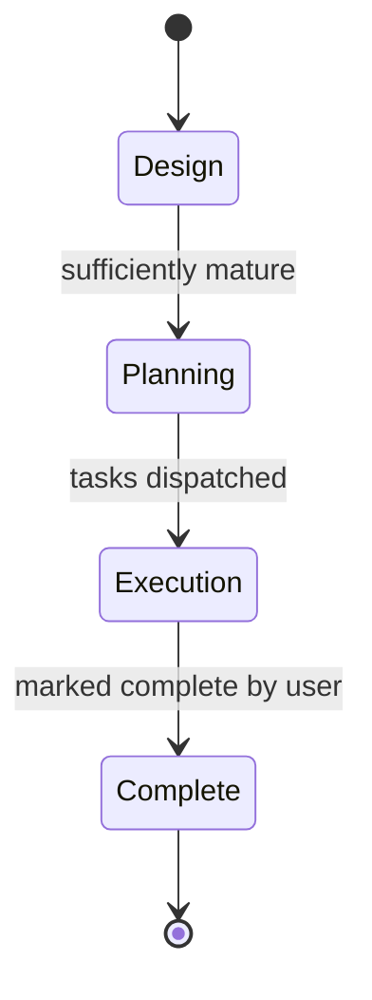

# Specification Design Plugin

## Problem

I like writing specifications when I am developing features. However these specifications keep on ending up in the repository, usually on a dedicated "planning" branch. I have no way of evolving a spec over time and seeing how _mature_ it is before I start building it.

This is a VS Code extension that lets me author, evolve and track specifications **outside of the repository**, measure their maturity against a set of criteria, break them down into tasks, and see how execution is tracking against the spec.

## Goals

- Manage specs for a repository from within VS Code, without storing them in that repository
- Make maturity of a spec visible: edge cases, compliance with non-functional criteria, design completeness
- Allow AI agents to review, critique and extend specs
- Break a mature spec down into tasks, and dispatch those tasks to agents in their own worktrees

## Non-goals

- Multi-user / team collaboration. This is a tool for one person.
- Stable repository identity across machines
- Specs that span multiple repositories
- A custom chart or Mermaid editor
- Managing the lifecycle after execution has started. The tool does not track PRs or task completion; the user marks a spec as complete.
- Automatically checking that an implementation aligns with its spec. If needed, this can be expressed as a non-functional criterion.

# Usage

The user interacts with the extension via a tab in the VS Code activity bar (left hand side). This shows a tree view of the specifications for the current repository.

- Clicking a spec opens its markdown document in an editor tab, like any other document
- The tree view has a context menu for editing the non-functional criteria (global defaults and repository overrides)
- Specs are written in markdown, with Mermaid diagrams embedded inline. Previewing uses standard VS Code markdown preview.
- A spec can have attached documents, for example an OpenAPI specification
- A spec can have sub-plans (tasks) created during the planning phase. These appear as children of the spec in the tree view.

The extension must resolve worktrees to their main repository, so that every worktree of a repository shows the same set of specifications.

# Storage

All data lives in `~/.spec-plans`, which is a git repository. **Nothing is ever written to the code repository or its worktrees.**

1. The extension reads the `origin` remote of the open workspace. Every worktree of a repository has the same remote.
2. It looks the remote up in `repositories.yml` to find the repository's folder within `~/.spec-plans`.
3. Criteria are resolved by combining `~/.spec-plans/.non-functional/` with the repository's `.non-functional/`. When both contain the same name, the repository version wins.
4. Executing a task creates a new worktree of the code repository. The spec stays in `~/.spec-plans`.

## Layout

```
~/.spec-plans/
  .git/
  repositories.yml                  # maps git remotes -> repository folder
  .non-functional/                  # global default criteria
    security.md
    observability.md
    disaster-recovery.md
    cost-efficiency.md
  githubcom-ceilingfish-foo/        # one folder per repository (folder name from repositories.yml)
    .non-functional/                # repository overrides / additions
      security.md                   # overrides the global security.md
      gdpr.md                       # adds a repository-specific criterion
    plans/
      <plan>/
        spec.md                     # the specification, with phase etc. in frontmatter
        openapi.yaml                # attached documents
        reviews/                    # history of agent reviews
        tasks/                      # sub-plans created in the planning phase
          01-<task>.md
```

## repositories.yml

Maps a git remote to a repository folder directly under `~/.spec-plans`. The folder name is always a single folder, never a nested path. By default it is derived from the remote URL: take the host and path, strip `.git`, remove dots, and join the segments with `-` (so `git@github.com:ceilingfish/foo.git` becomes `githubcom-ceilingfish-foo`). It can be changed to any single folder name.

```yaml
repositories:
  - remote: git@github.com:ceilingfish/foo.git
    path: githubcom-ceilingfish-foo
  - remote: https://gitlab.example.com/team/bar.git
    path: work-bar
```

Only the `origin` remote is used. Other remotes are ignored, and URLs aren't normalised: the URL is matched exactly as `origin` reports it. A repository without an `origin` remote can't be mapped automatically, so the extension should prompt the user to register it by hand.

## Commits

Changes are only committed when the user presses the **Commit** button in the tree view. Nothing is committed automatically.

# Non-Functional Criteria

When writing a specification there are usually non-functional requirements: security, observability, disaster recovery, cost efficiency. They rarely get addressed in a specification, because we tend to focus on the _functional_ requirements. This tool should help fix that.

- Each criterion is a markdown document, identified by its name (e.g. `security`)
- A criterion is a rubric. It must be **falsifiable** (a reviewer can say definitively whether a spec meets it) but also detailed
- Global defaults live in `~/.spec-plans/.non-functional/`
- A repository can override a criterion by creating a document with the same name in `~/.spec-plans/<repository>/.non-functional/`, or add new ones with new names
- A criterion may not apply to every spec (e.g. disaster recovery for a UI tweak). A review should be able to mark a criterion as not applicable, with a justification, rather than penalising the spec.

# Phases



## Design

Design covers both coming up with an idea and fully considering the options and ramifications of the change. An idea starts partial and is evolved towards a fully fledged plan.

An agent should be able to review a spec and tell us:

- How closely the spec conforms to each non-functional criterion
- How complete the concept is. Compared to the codebase, what aspects are missing?
- Which edge cases have not been considered

One capability should be "extract an API", which produces an OpenAPI spec attached to the plan.

The spec's maturity should be visible in the tree view and in the review results.

### Maturity

Maturity is the core idea of this tool. It is made up of:

1. **Non-functional compliance** - how closely the spec conforms to the applicable non-functional criteria
2. **Design completeness** - how well developed the concepts in the plan are, compared to the codebase
3. **Edge case coverage** - whether the spec accounts for the conceptual edge cases

The precise definition of maturity (scale, how each dimension is assessed, how a spec qualifies for Planning) is still to be defined. See Open Questions.

## Planning

Once we have a reasonably mature concept, the tool breaks it down into sub-plans (tasks). Each task appears as a sub-document under the plan.

Each task should include:

- A description of the deliverable
- Dependencies on other tasks
- A recommendation of which agent should carry it out

## Execution

Each task can be executed. Executing a task:

1. Creates a branch and a git worktree for the task
2. Dispatches an agent to start work in that worktree

While in execution, the tree view shows which tasks have been dispatched, and to which worktree and branch.

The tool doesn't track task progress or PRs. The user marks a plan as **complete** when they judge it finished.

# Open Questions

- **Maturity definition**: what scale, how each dimension is scored, and what threshold moves a spec from Design to Planning
- **Review output format**: how per-criterion results (met / partial / missing / not applicable, with evidence) are structured and stored in `reviews/`
- **Removing criteria**: can a repository disable a global criterion, and how is that expressed?
- **Task dispatch details**: base branch, branch naming, parallel vs sequential tasks, which agents are available- **skills.sh**: which existing skills (e.g. triage) could be reused for reviews

# Appendix: AI Integration Mechanisms

It is crucial that Claude, or any other AI agent, can read, review and extend specs. Because specs live outside the repository, an agent working in a repository or worktree cannot see them by default. The options below are not mutually exclusive.

## A. Files on disk, by convention

The agent is told the path to the spec (e.g. via prompt, or by granting access to `~/.spec-plans/<repository>`) and reads/writes the markdown directly.

| Advantages                                 | Disadvantages                                                                       |
| ------------------------------------------ | ----------------------------------------------------------------------------------- |
| Simplest possible option, nothing to build | No structure: agents may write reviews in inconsistent formats                      |
| Works with any agent that can read files   | Agents usually need explicit permission to access directories outside the workspace |
| Specs remain plain markdown                | Criteria resolution (global vs override) must be re-explained to every agent        |

## B. MCP server

The extension ships (or launches) an MCP server exposing tools such as `list_specs`, `get_spec`, `get_criteria` (already resolved for the repository), `record_review`, `create_task`.

| Advantages                                                    | Disadvantages                                    |
| ------------------------------------------------------------- | ------------------------------------------------ |
| Agent-agnostic: any MCP-capable agent can use it              | More to build and maintain                       |
| Structured inputs/outputs, so reviews are stored consistently | Must be registered with each agent               |
| Criteria resolution and git commits happen in one place       | Server lifecycle to manage (who starts it, when) |
| Works from any worktree, no filesystem permissions needed     |                                                  |

## C. Headless agent CLI, driven by the extension

The extension runs an agent CLI in non-interactive mode (e.g. `claude -p` with JSON output) with a review prompt, and parses the result.

| Advantages                                                                    | Disadvantages                                                                  |
| ----------------------------------------------------------------------------- | ------------------------------------------------------------------------------ |
| The extension controls when reviews run and where results go                  | Coupled to a specific CLI's flags and output format (can be made configurable) |
| The agent has full codebase access, so "compared to the codebase" is possible | Slow, and costs usage per review                                               |
| Natural fit for dispatching task execution in a worktree                      | Output parsing can be brittle                                                  |

## D. Direct LLM API from the extension

The extension calls a model API directly with the spec and criteria.

| Advantages                                      | Disadvantages                                              |
| ----------------------------------------------- | ---------------------------------------------------------- |
| Full control over prompts and structured output | Requires API keys and separate billing                     |
| Fast, predictable for criteria-only reviews     | No codebase access unless you build an agent loop yourself |
| No dependency on an installed agent             | Reinvents what agent CLIs already provide                  |

## E. VS Code chat participant / Language Model API

The extension registers a chat participant (e.g. `@spec`) using the models VS Code makes available.

| Advantages                                        | Disadvantages                                            |
| ------------------------------------------------- | -------------------------------------------------------- |
| Native to VS Code, no keys to manage              | Tied to whichever model provider is installed in VS Code |
| Conversational refinement of a spec feels natural | Limited agentic access to the codebase                   |
|                                                   | Not usable from agents running outside VS Code           |

## F. Claude Code plugin (skills + commands)

Ship a companion Claude Code plugin with skills such as `review-spec`, `plan-spec`, `extract-api`.

| Advantages                                                           | Disadvantages                                  |
| -------------------------------------------------------------------- | ---------------------------------------------- |
| Rich, reusable prompts; can reuse skills from skills.sh              | Claude-only, not "any agent"                   |
| Easy to iterate on review behaviour without rebuilding the extension | Still needs A or B to actually reach the specs |

## Recommendation

**B + C**: an MCP server as the single interface to specs, criteria and reviews (keeping storage and git commits in one place, and usable by any agent), with the extension using a configurable headless agent CLI to trigger reviews and dispatch tasks into worktrees. F can be layered on top later to package the review and planning prompts for Claude.
